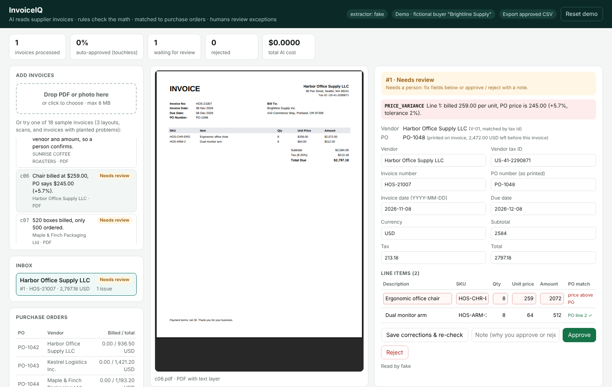
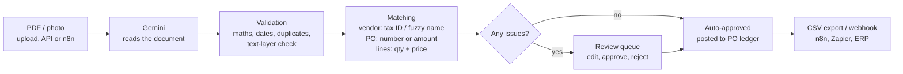

# InvoiceIQ — AI invoice processing with purchase-order matching

InvoiceIQ reads supplier invoices (PDFs or phone photos), checks them, matches them to purchase orders and
**approves the clean ones automatically**. Anything that doesn't add up waits for a person, with the reason
spelled out.

The AI only *reads* the document. Whether an invoice gets paid is decided by plain Python rules a finance team can
audit. That split is the whole design.

**Live demo:** _add your Render URL here_ (free hosting, so the first load can take about a minute)



## What it does

1. **Reads the document.** Gemini receives the PDF or image itself and returns the vendor, invoice number, dates,
   PO number, every line item, subtotal, tax and total **exactly as printed**. It handles any layout, US and European
   number/date formats (`2.400,00 €`, `11.03.2026`) and slightly tilted, blurry scans.
2. **Checks the maths and the facts.**
   - Line totals, subtotal and total are recomputed from the printed numbers.
   - Dates are sanity-checked, and duplicates are caught by file hash or by vendor + invoice number (so the same
     invoice arriving once as a PDF and once as a photo is caught too).
   - On PDFs, the invoice number and total must actually appear in the document's own text. That catches values the
     model made up.
3. **Matches the purchase order.**
   - The vendor is found by tax ID, or by fuzzy name ("Harbour Office Supplies" → *Harbor Office Supply LLC*,
     88% similar).
   - The PO is found from whatever is printed (`PO-1046`, `P.O. #1046`, `po 1046`). If none is printed, from the
     vendor + amount, and then a person is asked to confirm.
   - Every line is checked against what is still left on the PO: quantity, and price within a 2% tolerance.
     Closed POs, other vendors' POs and currency mismatches are flagged.
4. **Decides.** No issues means **auto-approved** and posted against the PO. Otherwise the invoice goes to
   **review**, with each issue explained. A duplicate is **rejected**. Reviewers can correct any field, and the
   invoice is re-checked immediately. Approvals go to CSV or to a webhook (n8n, Zapier, Make, your ERP).

## Results

`python -m eval.run_eval` processes 18 invoices: 3 layouts, 4 scans, euro and US formats, 10 clean and
8 with a planted problem (price above PO, quantity over PO, wrong total, wrong line, duplicate, unknown vendor,
closed PO, missing PO number). It scores every field and every line item against ground truth, plus the final
decision. See [eval/results.md](eval/results.md).

_Results table: run the eval and paste the summary here._

The baseline is what most teams try first: regexes on the PDF text. Even when it is tuned to these exact layouts,
it can't read scans or table rows, so line-item checks and PO matching never get the data they need.

Tests: `pytest` runs 39 tests offline. They cover normalisation, vendor matching, every validation rule, all 18
samples end to end, PO consumption, duplicate detection across file types, reviewer corrections, approval rules,
extraction failures and the HTTP API.

## How it is built



| Concern | How InvoiceIQ handles it |
|---|---|
| LLM mistakes or made-up numbers | The model is told to transcribe, not fix. Every number is re-checked by code, and PDF values are cross-checked against the PDF's own text. |
| Paying the same invoice twice | Duplicate check by file hash *and* by vendor + normalised invoice number, across PDFs and photos. |
| Overbilling | A ledger tracks what has been billed per PO line, so a second invoice for already-billed goods gets `QTY_OVER_PO`. |
| Explainability | Every issue has a code, a severity, the field it affects and a plain sentence ("billed 259.00 per unit, PO price is 245.00, +5.7%"). |
| Human control | Approving is blocked while blocking issues remain (unknown vendor, closed PO, duplicate, missing fields). Each decision records who made it and the note. |
| Untrusted uploads | The file type is detected from the bytes, not the name. Size limit and per-IP rate limit; the stored file name is never exposed. |
| Integrations | `POST /api/invoices` with an `X-API-Key` for n8n or scripts. An approval webhook. A CSV export for accounting. |
| Cost visibility | Tokens and cost are recorded per invoice and shown in the console. |

## Run it locally

```bash
python -m venv .venv && source .venv/bin/activate
pip install -r requirements.txt
cp .env.example .env               # add GEMINI_API_KEY (free at aistudio.google.com)
uvicorn app.main:app --reload --port 8000
# open http://localhost:8000 and click a sample, or drop your own invoice
```

You don't need a key for a quick look: `LLM_PROVIDER=fake` uses the samples' ground truth instead of a model.

```bash
pytest                                  # 39 tests, offline
python -m eval.run_eval                 # Gemini vs regex baseline -> eval/results.md
python -m scripts.make_samples          # regenerate the 18 sample invoices
```

## Use it from n8n (or any automation tool)

Set `INGEST_API_KEY` and `APPROVAL_WEBHOOK_URL` in `.env`. Then:

- **Inbound:** in n8n use an *Email Trigger (IMAP)* or *Google Drive Trigger*, then an *HTTP Request* node with
  `POST https://<your-app>/api/invoices`, body *Form-Data*, field `file` = the binary attachment, header
  `X-API-Key: <INGEST_API_KEY>`. The response is the full JSON: status, extracted fields, issues and match.
- **Outbound:** add a *Webhook* node in n8n and paste its URL into `APPROVAL_WEBHOOK_URL`. Each approval (automatic or
  by a reviewer) POSTs `{"event": "invoice.approved", "invoice": {...}, "po": {...}, "vendor": {...}}`. From there,
  create the bill in QuickBooks, Xero or NetSuite, or post it to Slack.

```bash
curl -F file=@invoice.pdf -H "X-API-Key: $INGEST_API_KEY" https://<your-app>/api/invoices
```

## Deploy (Render, free)

1. Push to GitHub.
2. Render → **New → Blueprint** → choose the repo (`render.yaml` configures everything).
3. Paste `GEMINI_API_KEY` when asked.

The demo database and uploads reset on every start (`DEMO_RESET_ON_START=true`).

## Swap in a real business

Replace `app/reference.py` with a sync from your ERP (vendors and open POs), or query it live in `db.py`.
Tolerances live in `.env`. The extractor is one small class, so OpenAI or Claude can replace Gemini, and
any extra field (bank details, payment terms, cost centre) is one line in `schema.py`.

## Project layout

```
app/
  extract.py    Gemini extractor (document in, JSON out), regex baseline, offline fake
  checks.py     validation rules, vendor/PO/line matching, decision; all plain Python
  pipeline.py   store → extract → validate → match → decide, reviewer edits, approvals, webhook
  db.py         SQLite: vendors, POs, invoices, PO ledger
  reference.py  demo vendors and purchase orders
  main.py       FastAPI: upload, samples, review, decisions, export, reset
static/index.html  review console (document preview next to editable fields)
scripts/make_samples.py  generates the 18 invoices + ground truth
eval/run_eval.py         field-level and decision-level evaluation
tests/                   pytest suite
```

## Limitations

- Single process, with SQLite. For volume, move to Postgres and a job queue (extraction runs ~3–10 s per invoice).
- The demo has no login because the data is fictional. A real deployment needs auth, roles and an approval limit
  per reviewer.
- Uploaded PDFs are served back inline for the preview. In production, serve them from a separate domain or object
  storage.
